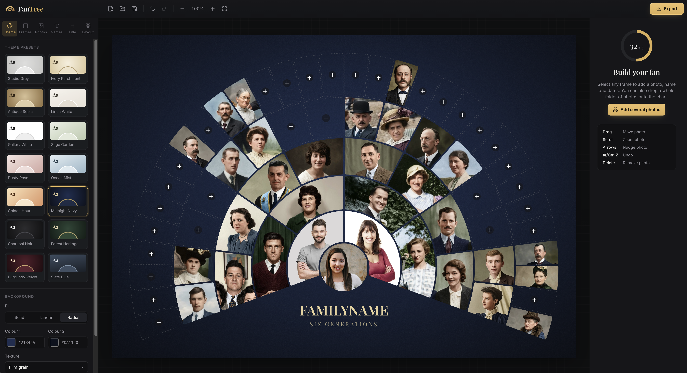

# FanTree

<p align="center">
  
</p>

<p align="center">
  Design beautiful family fan charts in your browser.
</p>

<p align="center">
  <a href="#installation">Install</a> &nbsp;|&nbsp;
  <a href="#key-features">Features</a> &nbsp;|&nbsp;
  <a href="#project-files">Project files</a> &nbsp;|&nbsp;
  <a href="#development">Development</a>
</p>

---

## Demo

<p align="center">
  
</p>

[View an example image export](docs/familyname-3840x2670.png)

## What Is It?

FanTree is a local, browser-based editor for creating ancestor fan charts. Add names, dates and photos to each generation, position every image precisely, choose a visual theme, and export a print-ready chart as PNG, JPEG, WebP or SVG.

Everything runs on your machine. Photos are never uploaded, and your chart is saved automatically in the browser that you use to open the app.

## Key Features

### Flexible Fan Charts

Build charts with a centre circle and up to six generations. Adjust the fan span up to 360°, centre size, gaps, corner rounding and other layout details while keeping each photo framed relative to its own slot.

### Photo Framing

Click an empty frame or drop images directly onto the chart. Fill multiple frames in order, then drag to reposition, scroll to zoom, or use the arrow keys to nudge a photo. Rotate, mirror and adjust brightness, contrast and saturation from the Inspector.

### Themes and Frame Styles

Start with one of 14 built-in themes or create a custom solid, linear or radial background. Add film grain, paper or linen texture, and a vignette. Frames support solid, outlined, dashed, dotted, faded, blurred and frosted-glass styles.

### Names and Titles

Add an optional name and dates for every person. Labels can follow the fan arc or run radially, use one of seven typefaces, and appear in a band or directly over the photo. Add a title and subtitle above the chart when you are ready to share it.

### High-Resolution Export

Export to PNG, JPEG, WebP or SVG at HD, 4K, 5K, 8K or 60 cm poster size at 300 dpi. Fonts are embedded in the output, and each photo is resampled to the exact size required by the export.

### Local-First Projects

Open the family tree in the Layout tab to select a different centre person. Your other branches and photo positions are kept when you switch, and are included in saved projects. In Layout, choose which parent is on the left to tell FanTree how to label each pair. FanTree autosaves locally and keeps full undo/redo history. Export a portable `.fantree` project file whenever you want a backup or need to move a chart to another browser or computer.

---

## Installation

### Linux and macOS

Install [Node.js 20+](https://nodejs.org/), clone the repository, install the dependencies and start the app:

```bash
npm install
npm start
```

FanTree will be available at `http://127.0.0.1:5178`.

To create and preview a production build:

```bash
npm run build
npm run preview
```

### Windows

Download the [FanTree 1.0.0 Windows installer](https://github.com/Leofric99/fantree/releases/tag/1.0.0), run the installer, and then launch FanTree from the Start menu or desktop shortcut.

## Project Files

Choose **Export project file** from the save icon or press `⌘/Ctrl S` to write one self-contained `.fantree` file. It includes:

- every photo, stored as the exact image data used by the app
- each photo's position, zoom, rotation, mirroring and adjustments
- all names and dates
- every theme, frame, label, title and layout setting

Choose **Import project file** from the folder icon or press `⌘/Ctrl O` to restore a project. You can also drop a `.fantree` file onto the app window. Importing replaces the current chart, and Undo restores the previous one.

A `.fantree` file is a standard zip archive containing `project.json` and an `images/` folder, so your photos are never locked in. Files are validated on import, and projects saved by earlier versions of FanTree remain supported.

## Keyboard Shortcuts

| Keys | Action |
| --- | --- |
| `⌘/Ctrl Z`, `⇧⌘/Ctrl Z` | Undo / redo |
| `⌘/Ctrl S` | Export project file |
| `⌘/Ctrl O` | Import project file |
| `⌘/Ctrl E` | Export chart |
| `⌘/Ctrl V` | Paste an image into the selected frame |
| Arrow keys (`⇧` for larger steps) | Nudge photo |
| Scroll / `⌘/Ctrl` + scroll | Zoom photo / zoom view |
| `+` / `−` | Zoom view |
| `Delete` | Remove photo |
| `Esc` | Deselect |

## Development

```bash
npm test           # unit tests (Vitest)
npm run lint       # oxlint
npm run typecheck
```

FanTree is built with React 19, TypeScript, Vite, Zustand, Immer and idb-keyval. The chart is rendered as a single SVG in [`src/components/FanChart.tsx`](src/components/FanChart.tsx), with geometry kept in [`src/lib/geometry.ts`](src/lib/geometry.ts). Exporting builds a self-contained SVG and rasterises it on a canvas.
